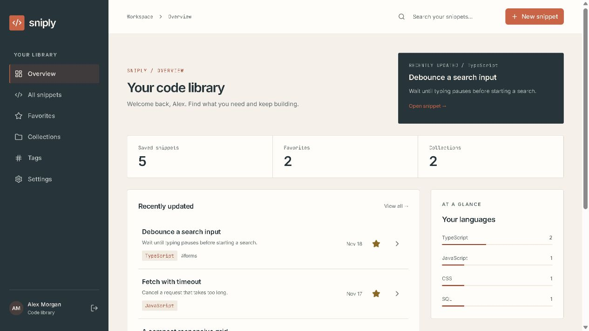
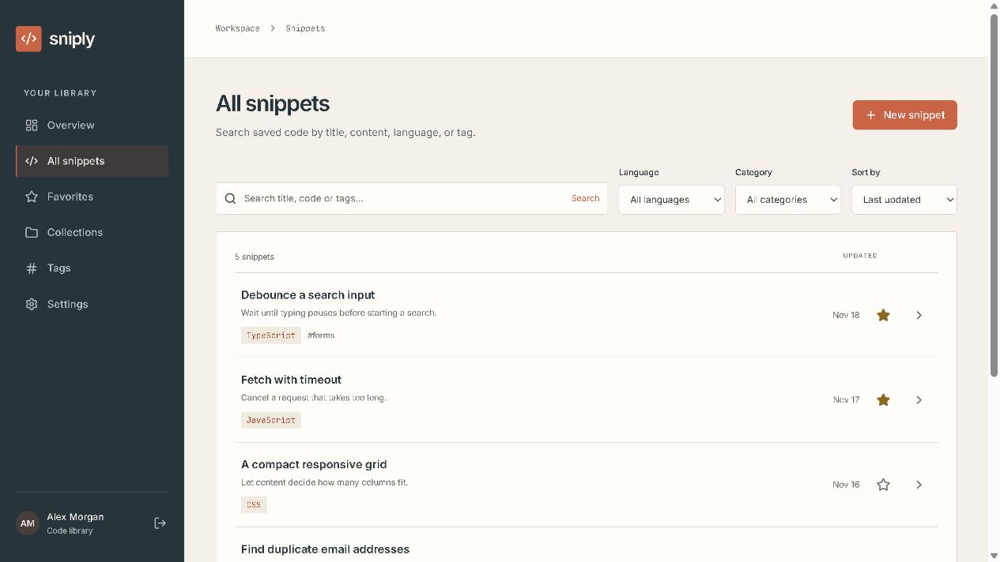
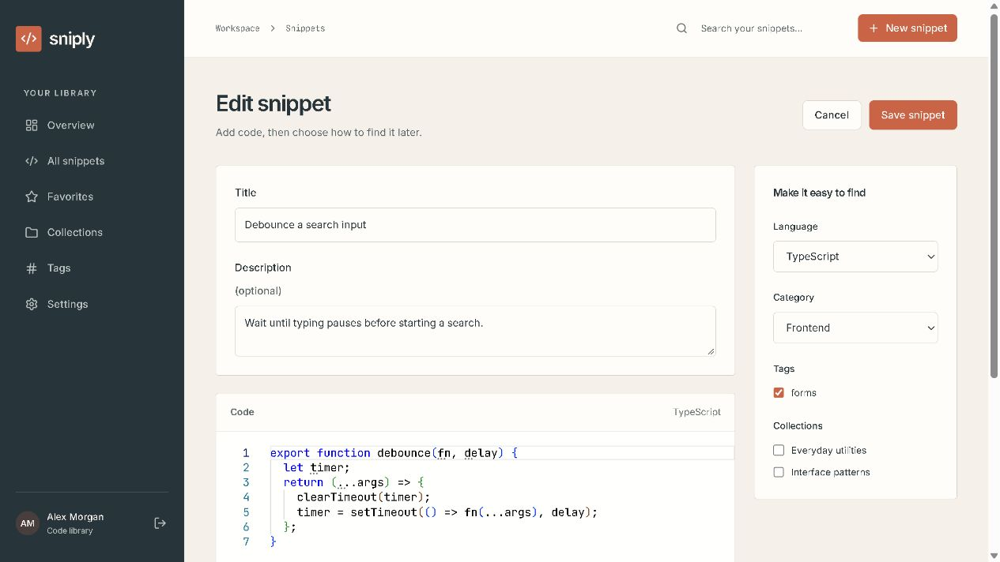
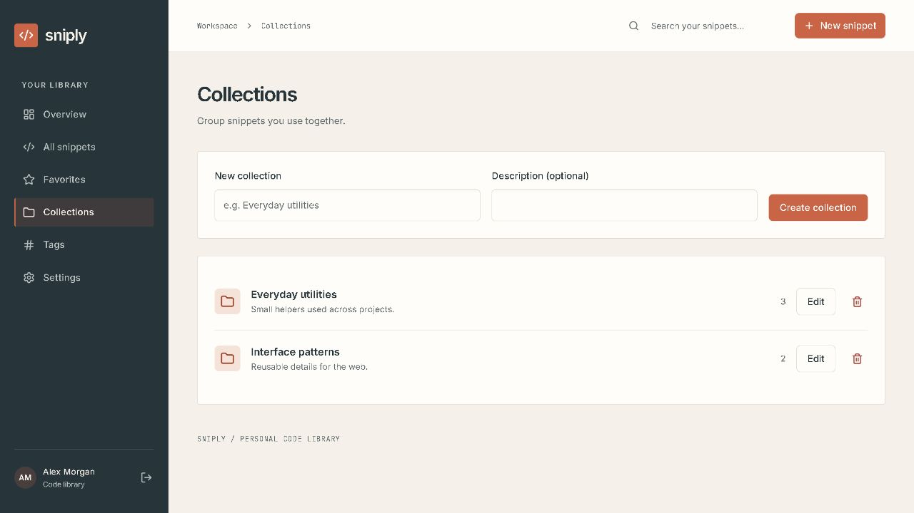
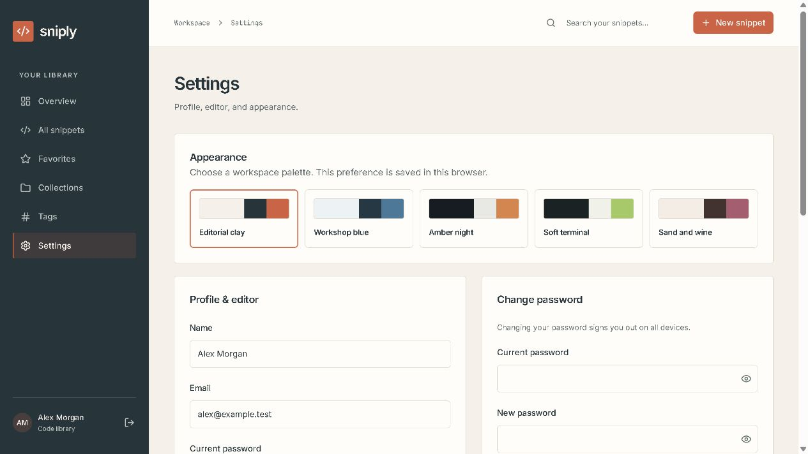
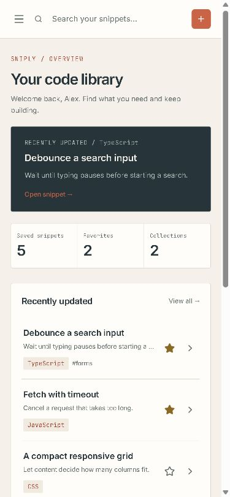
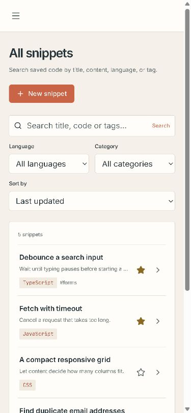
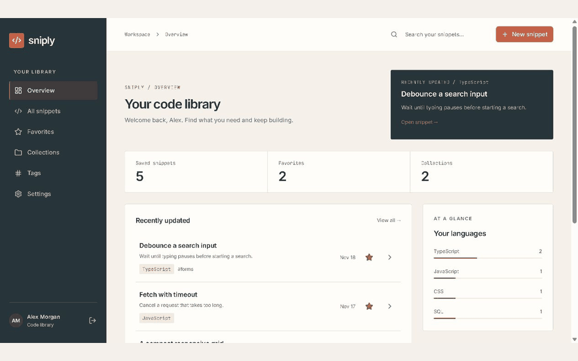

<p align="center"></p>
<h1 align="center">Sniply</h1>
<p align="center">Your code, always within reach.</p>

A personal code snippet manager with a React interface and an ASP.NET Core REST API. Save useful code, organize it into collections, find it with server-side search, and share selected snippets through revocable public links.

**Project year: 2024.** The author supplied the original project year. This repository implementation was reconstructed from the brief in November 2026.

**Stack:** React · TypeScript · Vite · Tailwind CSS · Monaco Editor · TanStack Query · ASP.NET Core · C# · Entity Framework Core · PostgreSQL

## Preview

The screenshots below show the running React interface with a temporary local fixture API and fictional sample data. The real API and PostgreSQL flows were verified separately. These are application captures, not design mockups.



<details>
<summary>Library, editor, collections, and mobile</summary>








</details>

### Walkthroughs

Captures of the running interface with fictional local fixture data, assembled as short page walkthroughs. Frames are held for readability; they do not imply measured interaction times.




## What it does

- Register an account, sign in, stay signed in, sign out, and reset a forgotten password.
- Create, read, update, delete, copy, and favorite snippets.
- Edit and view code with Monaco syntax highlighting, line numbers, indentation, word wrap, and local language workers.
- Search titles, descriptions, code, language names, and tags on the API. Filter by language, category, collection, or tag; sort by updated date, creation date, or title; browse paginated results.
- Manage collections, tags, categories, and custom language labels. Deleting a group preserves its snippets.
- View library counts, recently updated snippets, and language distribution.
- Create a public link for an individual snippet and revoke it later. Private snippets require their owner's account.
- Choose among five workspace palettes in Settings. The choice is saved in the browser. Update profile and editor preferences. Email changes require the current password; password changes revoke existing sessions.
- Use responsive desktop, tablet, and mobile layouts, keyboard navigation, loading/error/empty states, and deletion confirmation dialogs.

Code is stored and displayed as text. Sniply does not execute snippets. Never publish credentials or private code through a share link.

## Run locally

### Requirements

- Node.js 24 and npm.
- .NET 10 SDK and ASP.NET Core 10 runtime for native API execution.
- Docker Desktop with Linux containers, or a PostgreSQL instance. The included Compose database uses PostgreSQL 17.

This is a full-stack application: opening the frontend without the API and database is not a standalone demo.

### 1. Configure the environment

From the project root, using PowerShell:

```powershell
Copy-Item .env.example .env
```

Edit `.env` and set a private random `Jwt__Key` of at least 32 bytes. Set a local PostgreSQL password in both `POSTGRES_PASSWORD` and the password portion of `ConnectionStrings__Default`. Do not commit `.env`.

For example, generate a key locally with PowerShell:

```powershell
$secretBytes = New-Object byte[] 32
[Security.Cryptography.RandomNumberGenerator]::Create().GetBytes($secretBytes)
[Convert]::ToBase64String($secretBytes)
```

Copy the generated value into `Jwt__Key`. Do not post it in issues or screenshots.

### 2. Start the database and initialize its schema

```powershell
docker compose -p sniply up -d db
dotnet restore backend/Sniply.Api
./scripts/start-api.ps1 -Migrate
```

The migration command is explicit. Normal API startup does not apply migrations automatically. The default database port is `5438` to avoid occupying an existing PostgreSQL port.

### 3. Start the API

```powershell
./scripts/start-api.ps1
```

The script loads the root `.env`, sets the Development environment, and starts the API at `http://127.0.0.1:5088`. Environment files are not automatically loaded by an arbitrary `dotnet run` command.

### 4. Start the frontend in another terminal

```powershell
npm ci --prefix frontend
npm run dev --prefix frontend
```

Open [Sniply locally](http://localhost:5173), create an account, and save your first snippet. A new installation starts with built-in languages and an empty personal library. The fictional account shown in the screenshots is not installed automatically.

The Vite server proxies `/api` to the local backend. Use the same frontend hostname consistently when testing cookies. Set `Frontend__Url` to the frontend origin you actually use; reset links use this address.

### Run all services with Docker

After configuring `.env`:

```powershell
docker compose -p sniply build api web
docker compose -p sniply up -d db
docker compose -p sniply run --rm api --migrate
docker compose -p sniply up -d api web
```

Open [the frontend](http://localhost:5173). Stop the development services with `docker compose -p sniply stop`. Named volumes preserve the database and API keys. The web image runs the development server; it is not a production deployment template.

### EF Core tooling

The pinned local tool can also generate or inspect migrations:

```powershell
dotnet tool restore
dotnet ef migrations list --project backend/Sniply.Api
```

To apply migrations, use the environment-loading script above. Migration generation does not need a running database; application does.

## Password recovery and configuration

| Variable | Purpose |
| --- | --- |
| `ConnectionStrings__Default` | Native API PostgreSQL connection string |
| `Jwt__Key`, `Jwt__Issuer`, `Jwt__Audience` | Private signing key and token identifiers |
| `Cookies__Secure` | `false` only for local HTTP; use `true` with production HTTPS |
| `Frontend__Url` | Allowed frontend origin and reset-link base URL |
| `POSTGRES_PASSWORD` | Compose PostgreSQL password |
| `Mail__Host`, `Mail__Port`, `Mail__Tls` | SMTP server settings |
| `Mail__Username`, `Mail__Password`, `Mail__From` | SMTP credentials and sender |
| `Mail__DropDirectory` | Optional private local recovery-message directory |
| `DataProtection__Path` | Optional persistent ASP.NET data-protection key directory |

With no SMTP host in Development, password-reset messages are written to the API's private `.mail` directory. Each JSON message contains a short-lived reset URL. This directory is ignored by Git and must not be served publicly. The same flow uses SMTP when configured. No SMTP delivery is claimed without a provider test.

Production requires HTTPS, secure cookies, protected persistent data-protection keys, a valid SMTP sender, a configured host allowlist, database backups, and hosting configuration. Never expose the local development configuration directly to the Internet.

## Architecture

```text
frontend/src/
  components/       Navigation, shared controls, snippet rows, Monaco
  hooks/            Query helpers
  lib/              API client, types and pure validation helpers
  pages/            Authentication, library, editor, groups, settings
backend/Sniply.Api/
  Api/              HTTP controllers and request handling
  Application/      Account and library services, validation contracts
  Domain/           Users, snippets, groups, languages, refresh sessions
  Persistence/      EF Core mappings and PostgreSQL migrations
backend/Sniply.Tests/ Isolated API integration tests
```

The API owns authorization, validation, searching, filtering, pagination and persistence. TanStack Query manages server state in the UI. The access JWT stays in memory; a rotating, hashed refresh session uses an HttpOnly, SameSite=Strict cookie. Public endpoints return only shared code metadata and content, without owner email or private group information. Monaco and fonts are served locally; the editor is loaded on demand.

## Verification

```powershell
npm test --prefix frontend
npm run build --prefix frontend
npm audit --prefix frontend
dotnet test backend/Sniply.Tests -c Release
dotnet tool restore
dotnet ef migrations has-pending-model-changes --project backend/Sniply.Api
```

On Windows, stop the API with Ctrl+C in its terminal before rebuilding it or applying migrations, to avoid locked application files. The tests use Release so they can run alongside a Debug development API.

The API suite uses an isolated SQLite test database and does not modify your PostgreSQL data. It covers ownership isolation, search/pagination, validation, explicit/revocable sharing, session rotation/logout, password recovery and revocation, profile validation, and group deletion. A separate smoke check was performed against the real local PostgreSQL instance. SQLite tests do not replace PostgreSQL integration checks.

The frontend tests cover pure editor/URL/name helpers. Browser checks cover the real UI at desktop, tablet and phone widths; they are not represented as a complete automated end-to-end suite. The GitHub Actions workflow is included but has not run on a remote repository yet.

Monaco's editor/language workers produce large lazy-loaded assets and a bundle-size warning. The initial application bundle does not eagerly include the editor. A patched DOMPurify override is pinned for Monaco; review it when upgrading the editor.

## Current scope and next steps

The implemented application runs locally with a real API and database. No public deployment or hosted demo is configured. Five workspace palettes are available, including two dark options. Production email, hosting, backups and operational setup require deployment-specific configuration. See [STATUS.md](STATUS.md) for current verification evidence and pending work.

## Use of artificial intelligence

AI tools were used to support drafting, organizing and reviewing the documentation, developing the interface from the supplied brief, assisting with implementation and responsiveness, and preparing and reviewing automated test scenarios. The screenshots and walkthroughs were captured from the running React interface with fictional local fixture data rather than generated as mockups.

The product direction and requirements were supplied by the developer. Technical decisions, implementation review and responsibility for the code and final result remain with the developer. This reconstruction should be reviewed and understood by the developer before publication.
